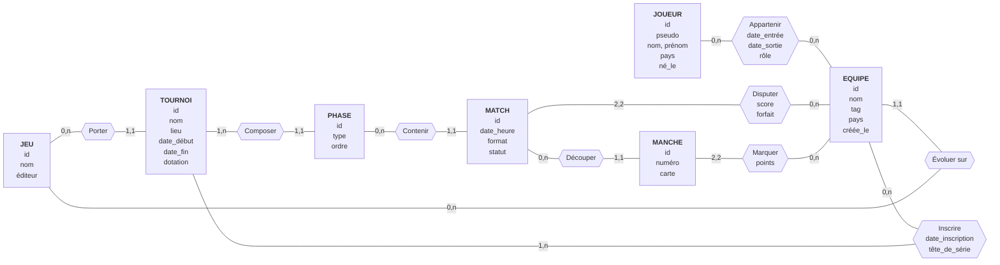

# Conception — Tournoi e-sport

> Brouillon de Matteo (cahier des charges + MCD). Les sections MLD (PostgreSQL, Neo4j) et « ce que le schéma ne garantit pas » sont à compléter par le reste du groupe.

## 1. Cahier des charges

Le sujet : une plateforme qui gère des tournois e-sport. Des équipes de joueurs s'inscrivent à un tournoi d'un jeu, jouent des matchs en poules puis en élimination directe, et chaque match est découpé en manches.

- **RG1.** Un jeu a un nom, unique sur la plateforme, et un éditeur. Un jeu peut avoir plusieurs tournois, ou aucun.
- **RG2.** Un tournoi porte sur un seul jeu. Il a un nom, un lieu (ou « en ligne »), une date de début, une date de fin et une dotation en euros.
- **RG3.** Un tournoi se déroule en une ou plusieurs phases, ordonnées : poules, puis élimination directe. Une phase appartient à un seul tournoi et a un type et un numéro d'ordre.
- **RG4.** Une équipe a un nom, unique sur la plateforme, un tag, un pays et une date de création. Elle évolue sur un seul jeu ; un jeu accueille plusieurs équipes, ou aucune.
- **RG5.** Une équipe peut s'inscrire à autant de tournois qu'elle veut, ou à aucun. Un tournoi accueille au moins une équipe (deux pour pouvoir jouer). L'inscription porte une date et une tête de série.
- **RG6.** Un joueur a un pseudo, unique sur la plateforme, un nom, un prénom, un pays et une date de naissance.
- **RG7.** Un joueur appartient à une équipe sur une période : date d'entrée, date de sortie facultative (vide tant qu'il y est), et un rôle. Il peut passer par plusieurs équipes, ou n'en avoir aucune. Une équipe peut n'avoir encore aucun joueur. À un instant donné, un joueur est dans au plus une équipe par jeu : il peut être dans deux équipes en même temps si elles évoluent sur des jeux différents.
- **RG8.** Un match appartient à une seule phase. Il a une date et une heure, un format (1, 3 ou 5 manches) et un statut : prévu, en cours, terminé ou annulé. Une phase contient plusieurs matchs, ou aucun.
- **RG9.** Un match oppose exactement deux équipes. Les deux équipes doivent être inscrites au tournoi de la phase du match. Une équipe peut disputer plusieurs matchs, ou aucun. Chaque équipe a un score de match : le nombre de manches gagnées, connu une fois le match joué.
- **RG10.** Un match joué est découpé en manches numérotées, chacune avec la carte jouée ; un match prévu n'en a pas encore. Une manche appartient à un seul match.
- **RG11.** Chaque manche donne un score (points) à chacune des deux équipes du match. Un match terminé a un vainqueur : il n'y a pas de match nul.
- **RG12.** Une équipe peut déclarer forfait pour un match. L'adversaire gagne alors avec le score maximal du format (par exemple 2-0 en trois manches), sans manche jouée, et le match passe au statut terminé. Le forfait est enregistré pour l'équipe concernée.

## 2. MCD

Sept entités : `JEU`, `TOURNOI`, `PHASE`, `EQUIPE`, `JOUEUR`, `MATCH`, `MANCHE`.
Quatre associations portent des données : `INSCRIRE`, `APPARTENIR`, `DISPUTER` (score et forfait), `MARQUER`.

### Cardinalités et règles

Chaque cardinalité répond à « pour un élément de l'entité de départ, combien d'éléments en face ? ».

| Association | Entité | Cardinalité | Règle | Lecture |
|---|---|---|---|---|
| Porter | JEU | 0,n | RG1 | un jeu a plusieurs tournois, ou aucun |
| Porter | TOURNOI | 1,1 | RG2 | un tournoi porte sur un seul jeu |
| Évoluer sur | EQUIPE | 1,1 | RG4 | une équipe évolue sur un seul jeu |
| Évoluer sur | JEU | 0,n | RG4 | un jeu accueille plusieurs équipes, ou aucune |
| Composer | TOURNOI | 1,n | RG3 | un tournoi a au moins une phase |
| Composer | PHASE | 1,1 | RG3 | une phase appartient à un seul tournoi |
| Contenir | PHASE | 0,n | RG8 | une phase contient plusieurs matchs, ou aucun |
| Contenir | MATCH | 1,1 | RG8 | un match appartient à une seule phase |
| Découper | MATCH | 0,n | RG10 | un match prévu n'a pas encore de manche |
| Découper | MANCHE | 1,1 | RG10 | une manche appartient à un seul match |
| Inscrire | EQUIPE | 0,n | RG5 | une équipe s'inscrit à autant de tournois qu'elle veut, ou à aucun |
| Inscrire | TOURNOI | 1,n | RG5 | un tournoi accueille au moins une équipe |
| Appartenir | JOUEUR | 0,n | RG7 | un joueur passe par plusieurs équipes, ou aucune |
| Appartenir | EQUIPE | 0,n | RG7 | une équipe a plusieurs joueurs au fil du temps, ou aucun |
| Disputer | MATCH | 2,2 | RG9, RG12 | un match oppose exactement deux équipes (score, forfait) |
| Disputer | EQUIPE | 0,n | RG9 | une équipe dispute plusieurs matchs, ou aucun |
| Marquer | MANCHE | 2,2 | RG11 | une manche donne un score à exactement deux équipes |
| Marquer | EQUIPE | 0,n | RG11 | une équipe marque dans plusieurs manches, ou aucune |

## 3. Décisions du métier

Ce que les règles ne disaient pas, et ce qui a été décidé :

| Question | Décision | Règle |
|---|---|---|
| Une équipe déclare forfait | L'adversaire gagne avec le score maximal, sans manche jouée ; le match passe à « terminé » ; le forfait est enregistré | RG12 |
| Un joueur dans deux équipes en même temps | Oui, une équipe par jeu au plus ; les équipes évoluent chacune sur un seul jeu | RG4, RG7 |
| Les équipes d'un match doivent-elles être inscrites au tournoi ? | Oui, obligatoirement | RG9 |
| Composition d'équipe par tournoi | Non : seul l'historique d'appartenance existe, la composition se déduit des dates | RG7 |

## 4. Ce que le schéma ne garantira pas (à reporter dans le MLD)

Pistes déjà repérées, à vérifier au moment du MLD :

- « Un tournoi a au moins une équipe » (RG5) et « au moins une phase » (RG3) : cardinalités minimales 1,n, à garantir dans le code.
- « Un match oppose deux équipes » (RG9) et « une manche donne un score à ces deux mêmes équipes » (RG11) : cohérence entre `DISPUTER` et `MARQUER`.
- « Les deux équipes d'un match sont inscrites au tournoi de sa phase » (RG9) : à garantir dans le code.
- « L'équipe inscrite à un tournoi évolue sur le jeu du tournoi » (RG2, RG4, RG5) : à garantir dans le code.
- « Un joueur est dans au plus une équipe par jeu à un instant donné », donc pas de chevauchement de périodes (RG7) : à garantir dans le code, ou par une contrainte d'exclusion si la base le permet.
- « Un match terminé a un vainqueur » (RG11) et le score de match égal au nombre de manches gagnées (RG9) : donnée recopiée ou calculée.
- Un forfait (RG12) : score maximal sans manche jouée, incohérent avec « le score est le nombre de manches gagnées » ; à garantir dans le code.

## 5. Requêtes prévues (bonus)

Les questions que la base doit pouvoir poser. Elles justifient les choix de bases : le relationnel pour les résultats, le graphe pour « qui a battu qui ».

| # | Question | Base | Règles |
|---|---|---|---|
| Q1 | Classement d'une poule : par équipe, victoires, défaites, manches gagnées et perdues | PostgreSQL | RG3, RG8, RG9 |
| Q2 | Historique d'une équipe : ses matchs triés par date, avec l'adversaire, le score et le tournoi | PostgreSQL | RG8, RG9 |
| Q3 | Matchs d'un joueur : les matchs joués par son équipe pendant sa période d'appartenance | PostgreSQL | RG7, RG9 |
| Q4 | Composition actuelle d'une équipe (joueurs sans date de sortie) | PostgreSQL | RG7 |
| Q5 | Palmarès : tournois remportés par une équipe (vainqueur de la finale de la dernière phase) | PostgreSQL | RG3, RG11 |
| Q6 | Qui a battu qui : les équipes battues par une équipe donnée | Neo4j | RG9, RG11 |
| Q7 | Chaîne de victoires : A a battu B qui a battu C, jusqu'à trois niveaux | Neo4j | RG9, RG11 |
| Q8 | Adversaires communs de deux équipes | Neo4j | RG9 |

Q1 à Q5 sont écrites en SQL par Matteo une fois le MLD posé ; Q6 à Q8 en Cypher par Thomas.
