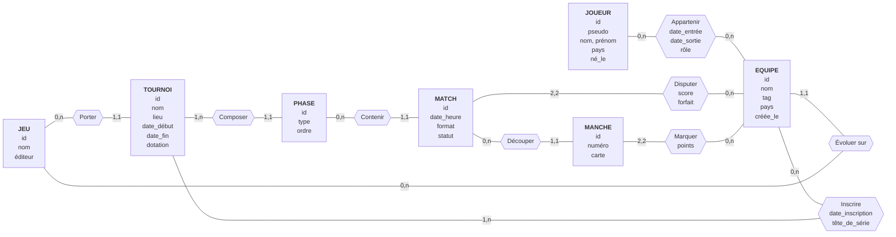

# Conception — Tournoi e-sport

> Cahier des charges, MCD et requêtes : Matteo. MLD PostgreSQL et « ce que le schéma ne garantit pas » : Armand. MLD Neo4j : Aurel (`docs/mld-neo4j.md`).

## 1. Cahier des charges

Le sujet : une plateforme qui gère des tournois e-sport. Des équipes de joueurs s'inscrivent à un tournoi d'un jeu, jouent des matchs en poules puis en élimination directe, et chaque match est découpé en manches.

- **RG1.** Un jeu a un nom, unique sur la plateforme, et un éditeur. Un jeu peut avoir plusieurs tournois, ou aucun.
- **RG2.** Un tournoi porte sur un seul jeu. Il a un nom, un lieu (ou « en ligne »), une date de début, une date de fin et une dotation en euros.
- **RG3.** Un tournoi se déroule en une ou plusieurs phases, ordonnées : poules, puis élimination directe. Une phase appartient à un seul tournoi et a un type et un numéro d'ordre.
- **RG4.** Une équipe a un nom, unique sur la plateforme, un tag, un pays et une date de création. Elle évolue sur un seul jeu ; un jeu accueille plusieurs équipes, ou aucune.
- **RG5.** Une équipe peut s'inscrire à autant de tournois qu'elle veut, ou à aucun. Un tournoi accueille au moins une équipe (deux pour pouvoir jouer). L'inscription porte une date et une tête de série.
- **RG6.** Un joueur a un pseudo, unique sur la plateforme, un nom, un prénom, un pays et une date de naissance.
- **RG7.** Un joueur appartient à une équipe sur une période : date d'entrée, date de sortie facultative (vide tant qu'il y est), et un rôle. Il peut passer par plusieurs équipes, ou n'en avoir aucune. Une équipe peut n'avoir encore aucun joueur. À un instant donné, un joueur est dans au plus une équipe par jeu : il peut être dans deux équipes en même temps si elles évoluent sur des jeux différents.
- **RG8.** Un match appartient à une seule phase. Il a une date et une heure, un format (1, 3 ou 5 manches) et un statut : prévu, en cours, terminé ou annulé. Une phase contient plusieurs matchs, ou aucun.
- **RG9.** Un match oppose exactement deux équipes. Les deux équipes doivent être inscrites au tournoi de la phase du match. Une équipe peut disputer plusieurs matchs, ou aucun. Chaque équipe a un score de match : le nombre de manches gagnées, connu une fois le match joué.
- **RG10.** Un match joué est découpé en manches numérotées, chacune avec la carte jouée ; un match prévu n'en a pas encore. Une manche appartient à un seul match.
- **RG11.** Chaque manche donne un score (points) à chacune des deux équipes du match. Un match terminé a un vainqueur : il n'y a pas de match nul.
- **RG12.** Une équipe peut déclarer forfait pour un match. L'adversaire gagne alors avec le score maximal du format (par exemple 2-0 en trois manches), sans manche jouée, et le match passe au statut terminé. Le forfait est enregistré pour l'équipe concernée.

## 2. MCD

Sept entités : `JEU`, `TOURNOI`, `PHASE`, `EQUIPE`, `JOUEUR`, `MATCH`, `MANCHE`.
Quatre associations portent des données : `INSCRIRE`, `APPARTENIR`, `DISPUTER` (score et forfait), `MARQUER`.

### Cardinalités et règles

Chaque cardinalité répond à « pour un élément de l'entité de départ, combien d'éléments en face ? ».

| Association | Entité | Cardinalité | Règle | Lecture |
|---|---|---|---|---|
| Porter | JEU | 0,n | RG1 | un jeu a plusieurs tournois, ou aucun |
| Porter | TOURNOI | 1,1 | RG2 | un tournoi porte sur un seul jeu |
| Évoluer sur | EQUIPE | 1,1 | RG4 | une équipe évolue sur un seul jeu |
| Évoluer sur | JEU | 0,n | RG4 | un jeu accueille plusieurs équipes, ou aucune |
| Composer | TOURNOI | 1,n | RG3 | un tournoi a au moins une phase |
| Composer | PHASE | 1,1 | RG3 | une phase appartient à un seul tournoi |
| Contenir | PHASE | 0,n | RG8 | une phase contient plusieurs matchs, ou aucun |
| Contenir | MATCH | 1,1 | RG8 | un match appartient à une seule phase |
| Découper | MATCH | 0,n | RG10 | un match prévu n'a pas encore de manche |
| Découper | MANCHE | 1,1 | RG10 | une manche appartient à un seul match |
| Inscrire | EQUIPE | 0,n | RG5 | une équipe s'inscrit à autant de tournois qu'elle veut, ou à aucun |
| Inscrire | TOURNOI | 1,n | RG5 | un tournoi accueille au moins une équipe |
| Appartenir | JOUEUR | 0,n | RG7 | un joueur passe par plusieurs équipes, ou aucune |
| Appartenir | EQUIPE | 0,n | RG7 | une équipe a plusieurs joueurs au fil du temps, ou aucun |
| Disputer | MATCH | 2,2 | RG9, RG12 | un match oppose exactement deux équipes (score, forfait) |
| Disputer | EQUIPE | 0,n | RG9 | une équipe dispute plusieurs matchs, ou aucun |
| Marquer | MANCHE | 2,2 | RG11 | une manche donne un score à exactement deux équipes |
| Marquer | EQUIPE | 0,n | RG11 | une équipe marque dans plusieurs manches, ou aucune |

## 3. Décisions du métier

Ce que les règles ne disaient pas, et ce qui a été décidé :

| Question | Décision | Règle |
|---|---|---|
| Une équipe déclare forfait | L'adversaire gagne avec le score maximal, sans manche jouée ; le match passe à « terminé » ; le forfait est enregistré | RG12 |
| Un joueur dans deux équipes en même temps | Oui, une équipe par jeu au plus ; les équipes évoluent chacune sur un seul jeu | RG4, RG7 |
| Les équipes d'un match doivent-elles être inscrites au tournoi ? | Oui, obligatoirement | RG9 |
| Composition d'équipe par tournoi | Non : seul l'historique d'appartenance existe, la composition se déduit des dates | RG7 |

## 4. MLD et ce que le schéma ne garantit pas

### 4.1 MLD PostgreSQL

PostgreSQL porte tout le MCD. Le DDL est dans `modele/postgres/schema.sql` : chaque contrainte y est commentée avec sa règle.

**Règles de passage** (séance 1) :

1. Une entité devient une table ; son identifiant devient la clé primaire.
2. Une association dont un côté a une cardinalité maximale de 1 ne devient pas une table : c'est une **clé étrangère** du côté « 1 », `NOT NULL` si la cardinalité minimale est 1.
3. Une association (n,n) devient une **table**. Sa clé primaire est faite des clés des deux entités, plus ce qu'il faut pour distinguer deux lignes. Les données portées par l'association deviennent ses colonnes.

**Tables.** La clé primaire est soulignée, une clé étrangère est précédée de `#`.

| Table | Colonnes | Contraintes | Règle |
|---|---|---|---|
| `jeu` | <u>id_jeu</u>, nom, editeur | `UNIQUE (nom)` | RG1 |
| `tournoi` | <u>id_tournoi</u>, #id_jeu, nom, lieu, date_debut, date_fin, dotation | `date_fin >= date_debut`, `dotation >= 0` | RG2 |
| `phase` | <u>id_phase</u>, #id_tournoi, type, ordre | `UNIQUE (id_tournoi, ordre)`, `type IN ('poules', 'elimination')`, `ordre >= 1` | RG3 |
| `equipe` | <u>id_equipe</u>, #id_jeu, nom, tag, pays, cree_le | `UNIQUE (nom)` | RG4 |
| `joueur` | <u>id_joueur</u>, pseudo, nom, prenom, pays, ne_le | `UNIQUE (pseudo)` | RG6 |
| `appartenir` | <u>#id_joueur, #id_equipe, date_entree</u>, date_sortie, role | `date_sortie IS NULL OR date_sortie >= date_entree` | RG7 |
| `inscrire` | <u>#id_tournoi, #id_equipe</u>, date_inscription, tete_de_serie | `UNIQUE (id_tournoi, tete_de_serie)`, `tete_de_serie >= 1` | RG5 |
| `match` | <u>id_match</u>, #id_phase, date_heure, format, statut | `format IN (1, 3, 5)`, `statut IN ('prevu', 'en_cours', 'termine', 'annule')` | RG8 |
| `disputer` | <u>#id_match, #id_equipe</u>, score, forfait | `score >= 0` | RG9, RG12 |
| `manche` | <u>id_manche</u>, #id_match, numero, carte | `UNIQUE (id_match, numero)`, `numero >= 1` | RG10 |
| `marquer` | <u>#id_manche, #id_equipe</u>, points | `points >= 0` | RG11 |

Toutes les clés étrangères sont `NOT NULL`. Un index est posé sur chaque clé étrangère qui n'est pas déjà couverte par une clé primaire ou unique : PostgreSQL ne les indexe pas tout seul, et Q1 à Q5 passent toutes par ces jointures.

**Comment chaque association est rangée, et pourquoi.**

| Association | Cardinalités | Rangement | Pourquoi |
|---|---|---|---|
| Porter | JEU (0,n) — TOURNOI (1,1) | `tournoi.id_jeu`, `NOT NULL` | un tournoi a un seul jeu (règle 2) |
| Évoluer sur | EQUIPE (1,1) — JEU (0,n) | `equipe.id_jeu`, `NOT NULL` | une équipe a un seul jeu (règle 2) |
| Composer | TOURNOI (1,n) — PHASE (1,1) | `phase.id_tournoi`, `NOT NULL` | une phase a un seul tournoi (règle 2) |
| Contenir | PHASE (0,n) — MATCH (1,1) | `match.id_phase`, `NOT NULL` | un match a une seule phase (règle 2) |
| Découper | MATCH (0,n) — MANCHE (1,1) | `manche.id_match`, `NOT NULL` | une manche a un seul match (règle 2) |
| Inscrire | EQUIPE (0,n) — TOURNOI (1,n) | table `inscrire` | (n,n), porte la date et la tête de série (règle 3) |
| Appartenir | JOUEUR (0,n) — EQUIPE (0,n) | table `appartenir` | (n,n), porte la période et le rôle. La date d'entrée est dans la clé : un joueur peut revenir dans une équipe |
| Disputer | MATCH (2,2) — EQUIPE (0,n) | table `disputer` | (n,n), porte le score et le forfait. Deux lignes par match |
| Marquer | MANCHE (2,2) — EQUIPE (0,n) | table `marquer` | (n,n), porte les points. Deux lignes par manche |

**Trois choix à signaler.**

- `inscrire.tete_de_serie` accepte `NULL` : l'organisateur fixe les têtes de série après les inscriptions. La contrainte d'unicité laisse passer plusieurs `NULL`, puis refuse deux équipes au même rang.
- `disputer.score` accepte `NULL` : RG9 dit que le score est « connu une fois le match joué ».
- Le vainqueur d'un match n'est pas stocké : c'est la ligne `disputer` au plus haut score. En revanche `disputer.score` est une redondance voulue avec `marquer` : un forfait (RG12) donne un score sans aucune manche, donc le score ne se déduit pas toujours des manches (voir l'ADR 0001, « Normalisation et dénormalisation »).

### 4.2 MLD Neo4j

Neo4j ne reprend que ce qui se lit en suivant des liens : deux étiquettes, `:Equipe` et `:Joueur`, et deux relations, `A_BATTU` et `A_JOUE_POUR`. Le modèle complet, la façon dont chaque élément du MCD y est rangé et la répartition des données entre les deux bases sont dans [`docs/mld-neo4j.md`](docs/mld-neo4j.md).

### 4.3 Ce que le schéma ne garantit pas

Le schéma relationnel tient les unicités, les domaines de valeurs et les liens. Il ne tient pas les règles qui portent sur **plusieurs lignes** ou sur **plusieurs tables** à la fois. Chacune est appliquée dans le code qui écrit dans PostgreSQL, à l'intérieur d'une transaction ; la dernière colonne dit où, dans l'application du bonus.

| Règle | Pourquoi le schéma ne la tient pas | Où elle est garantie |
|---|---|---|
| Un tournoi a au moins une phase (RG3) et au moins une équipe, deux pour jouer (RG5) | cardinalité minimale 1 d'un côté (1,n) : une clé étrangère n'oblige pas à avoir des lignes en face | au démarrage du tournoi (`metier/tournoi`) |
| Les phases se suivent : poules, puis élimination directe (RG3) | l'unicité de `(id_tournoi, ordre)` ne dit rien du type | à l'ajout d'une phase (`metier/tournoi`) |
| L'équipe inscrite évolue sur le jeu du tournoi (RG2, RG4, RG5) | le jeu est sur `equipe` et sur `tournoi`, pas dans `inscrire` | à l'inscription (`services/tournois`) |
| Un joueur est dans au plus une équipe par jeu à un instant donné (RG7) | le jeu est sur `equipe`, pas sur `appartenir` : une contrainte `EXCLUDE` ne peut pas le voir | à l'entrée d'un joueur, ligne du joueur verrouillée (`metier/appartenance`) |
| Un match oppose exactement deux équipes (RG9) | `disputer` accepte 0, 1 ou 3 lignes pour un match ; la clé empêche seulement deux fois la même équipe | le match et ses deux lignes sont créés ensemble (`services/moteur`) |
| Les deux équipes d'un match sont inscrites au tournoi de sa phase (RG9) | `disputer` ne porte pas `id_tournoi` : pas de clé étrangère possible vers `inscrire` | les matchs sont générés à partir des inscrits (`services/moteur`) |
| Un match prévu n'a pas de manche ; les manches sont numérotées sans trou (RG10) | règle entre `match.statut` et `manche` | à la saisie d'une manche (`services/moteur`) |
| Une manche donne des points aux deux équipes du match, et à elles seules (RG11) | `marquer` ne sait pas quelles équipes disputent le match | les deux lignes sont écrites avec la manche (`services/moteur`) |
| Une manche n'est pas nulle ; un match terminé a un vainqueur (RG11) | un `CHECK` ne compare pas deux lignes | à la saisie (`metier/score`) |
| `disputer.score` est le nombre de manches gagnées, sauf forfait (RG9) | valeur recopiée, que rien ne recalcule dans la base | le score est calculé, jamais saisi (`metier/score`) |
| Un forfait donne le score maximal du format, sans manche, et termine le match (RG12) | règle entre `disputer`, `match` et `manche` | à la déclaration du forfait (`metier/score`, `services/moteur`) |
| Une équipe ne change pas de jeu une fois qu'elle a disputé un match (RG4) | `equipe.id_jeu` reste modifiable | à la modification d'une équipe (`services/equipes`) |

**Ce qui aurait pu être tenu par le schéma, et pourquoi nous ne l'avons pas fait.** Recopier `id_jeu` dans `appartenir`, avec une clé étrangère composée vers `equipe (id_equipe, id_jeu)` et l'extension `btree_gist`, permettrait une contrainte `EXCLUDE USING gist` contre le chevauchement de RG7. De même, recopier `id_tournoi` dans `disputer` permettrait une clé étrangère vers `inscrire`. Dans les deux cas, on ajoute une colonne redondante pour gagner une contrainte : nous avons gardé le schéma en troisième forme normale et placé ces deux règles dans le code, où elles sont testées.

Neo4j, lui, ne vérifie aucune règle métier : il ne reçoit que des matchs déjà validés par PostgreSQL (voir « Ce que le graphe ne garantit pas » dans `docs/mld-neo4j.md`).

## 5. Requêtes prévues (bonus)

Les questions que la base doit pouvoir poser. Elles justifient les choix de bases : le relationnel pour les résultats, le graphe pour « qui a battu qui ».

| # | Question | Base | Règles |
|---|---|---|---|
| Q1 | Classement d'une poule : par équipe, victoires, défaites, manches gagnées et perdues | PostgreSQL | RG3, RG8, RG9 |
| Q2 | Historique d'une équipe : ses matchs triés par date, avec l'adversaire, le score et le tournoi | PostgreSQL | RG8, RG9 |
| Q3 | Matchs d'un joueur : les matchs joués par son équipe pendant sa période d'appartenance | PostgreSQL | RG7, RG9 |
| Q4 | Composition actuelle d'une équipe (joueurs sans date de sortie) | PostgreSQL | RG7 |
| Q5 | Palmarès : tournois remportés par une équipe (vainqueur de la finale de la dernière phase) | PostgreSQL | RG3, RG11 |
| Q6 | Qui a battu qui : les équipes battues par une équipe donnée | Neo4j | RG9, RG11 |
| Q7 | Chaîne de victoires : A a battu B qui a battu C, jusqu'à trois niveaux | Neo4j | RG9, RG11 |
| Q8 | Adversaires communs de deux équipes | Neo4j | RG9 |

Q1 à Q5 sont écrites en SQL par Matteo une fois le MLD posé ; Q6 à Q8 en Cypher par Aurel (`modele/neo4j/requetes.cypher`).
