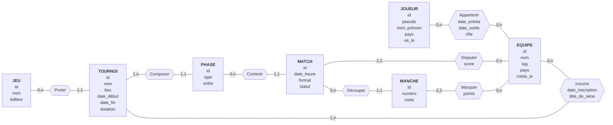

# Conception — Tournoi e-sport

> Brouillon de Matteo (cahier des charges + MCD). Les sections MLD (PostgreSQL, Neo4j) et « ce que le schéma ne garantit pas » sont à compléter par le reste du groupe.

## 1. Cahier des charges

Le sujet : une plateforme qui gère des tournois e-sport. Des équipes de joueurs s'inscrivent à un tournoi d'un jeu, jouent des matchs en poules puis en élimination directe, et chaque match est découpé en manches.

- **RG1.** Un jeu a un nom, unique sur la plateforme, et un éditeur. Un jeu peut avoir plusieurs tournois, ou aucun.
- **RG2.** Un tournoi porte sur un seul jeu. Il a un nom, un lieu (ou « en ligne »), une date de début, une date de fin et une dotation en euros.
- **RG3.** Un tournoi se déroule en une ou plusieurs phases, ordonnées : poules, puis élimination directe. Une phase appartient à un seul tournoi et a un type et un numéro d'ordre.
- **RG4.** Une équipe a un nom, unique sur la plateforme, un tag, un pays et une date de création.
- **RG5.** Une équipe peut s'inscrire à autant de tournois qu'elle veut, ou à aucun. Un tournoi accueille au moins une équipe (deux pour pouvoir jouer). L'inscription porte une date et une tête de série.
- **RG6.** Un joueur a un pseudo, unique sur la plateforme, un nom, un prénom, un pays et une date de naissance.
- **RG7.** Un joueur appartient à une équipe sur une période : date d'entrée, date de sortie facultative (vide tant qu'il y est), et un rôle. Il peut passer par plusieurs équipes, ou n'en avoir aucune. Une équipe peut n'avoir encore aucun joueur.
- **RG8.** Un match appartient à une seule phase. Il a une date et une heure, un format (1, 3 ou 5 manches) et un statut : prévu, en cours, terminé ou annulé. Une phase contient plusieurs matchs, ou aucun.
- **RG9.** Un match oppose exactement deux équipes. Une équipe peut disputer plusieurs matchs, ou aucun. Chaque équipe a un score de match : le nombre de manches gagnées, connu une fois le match joué.
- **RG10.** Un match joué est découpé en manches numérotées, chacune avec la carte jouée ; un match prévu n'en a pas encore. Une manche appartient à un seul match.
- **RG11.** Chaque manche donne un score (points) à chacune des deux équipes du match. Un match terminé a un vainqueur : il n'y a pas de match nul.

## 2. MCD

Sept entités : `JEU`, `TOURNOI`, `PHASE`, `EQUIPE`, `JOUEUR`, `MATCH`, `MANCHE`.
Quatre associations portent des données : `INSCRIRE`, `APPARTENIR`, `DISPUTER`, `MARQUER`.

### Cardinalités et règles

Chaque cardinalité répond à « pour un élément de l'entité de départ, combien d'éléments en face ? ».

| Association | Entité | Cardinalité | Règle | Lecture |
|---|---|---|---|---|
| Porter | JEU | 0,n | RG1 | un jeu a plusieurs tournois, ou aucun |
| Porter | TOURNOI | 1,1 | RG2 | un tournoi porte sur un seul jeu |
| Composer | TOURNOI | 1,n | RG3 | un tournoi a au moins une phase |
| Composer | PHASE | 1,1 | RG3 | une phase appartient à un seul tournoi |
| Contenir | PHASE | 0,n | RG8 | une phase contient plusieurs matchs, ou aucun |
| Contenir | MATCH | 1,1 | RG8 | un match appartient à une seule phase |
| Découper | MATCH | 0,n | RG10 | un match prévu n'a pas encore de manche |
| Découper | MANCHE | 1,1 | RG10 | une manche appartient à un seul match |
| Inscrire | EQUIPE | 0,n | RG5 | une équipe s'inscrit à autant de tournois qu'elle veut, ou à aucun |
| Inscrire | TOURNOI | 1,n | RG5 | un tournoi accueille au moins une équipe |
| Appartenir | JOUEUR | 0,n | RG7 | un joueur passe par plusieurs équipes, ou aucune |
| Appartenir | EQUIPE | 0,n | RG7 | une équipe a plusieurs joueurs au fil du temps, ou aucun |
| Disputer | MATCH | 2,2 | RG9 | un match oppose exactement deux équipes |
| Disputer | EQUIPE | 0,n | RG9 | une équipe dispute plusieurs matchs, ou aucun |
| Marquer | MANCHE | 2,2 | RG11 | une manche donne un score à exactement deux équipes |
| Marquer | EQUIPE | 0,n | RG11 | une équipe marque dans plusieurs manches, ou aucune |

## 3. Questions au métier

Ce que les règles ne disent pas encore :

- Une équipe forfait : le match est-il perdu 0-2 sans manche jouée, ou annulé ?
- Un joueur peut-il être dans deux équipes à la fois (jeux différents) ? RG7 ne l'interdit pas.
- Les deux équipes d'un match doivent-elles toutes deux être inscrites au tournoi de sa phase ? (RG5 et RG9 ne le disent pas.)
- Une équipe a-t-elle une composition par tournoi, ou seulement l'historique de RG7 ?

## 4. Ce que le schéma ne garantira pas (à reporter dans le MLD)

Pistes déjà repérées, à vérifier au moment du MLD :

- « Un tournoi a au moins une équipe » (RG5) et « au moins une phase » (RG3) : cardinalités minimales 1,n, à garantir dans le code.
- « Un match oppose deux équipes » (RG9) et « une manche donne un score à ces deux mêmes équipes » (RG11) : cohérence entre `DISPUTER` et `MARQUER`.
- « Les équipes d'un match sont inscrites au tournoi de sa phase » : à garantir dans le code.
- « Un match terminé a un vainqueur » (RG11) et le score de match égal au nombre de manches gagnées (RG9) : donnée recopiée ou calculée.
- Pas de chevauchement de périodes pour un même joueur dans une équipe (RG7).
