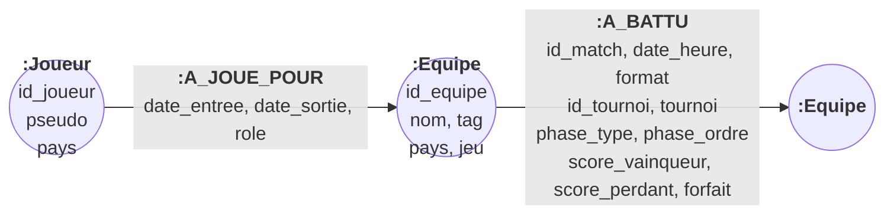

# MLD Neo4j — le graphe « qui a battu qui »

> Partie d'Aurel. Complète `CONCEPTION.md` (règles de gestion, MCD, requêtes Q1 à Q8). Choix de la base : `docs/adr/0001-postgresql-et-neo4j.md`.

Neo4j ne reprend **pas** tout le MCD. Il reçoit uniquement ce qui se lit en suivant des liens (Q6 à Q8). PostgreSQL fait foi, et Neo4j en est une copie reconstruite par `modele/neo4j/importer.py`.



## Nœuds

| Étiquette | Propriétés | Clé (unicité) | Vient de | Règle |
|---|---|---|---|---|
| `:Equipe` | `id_equipe`, `nom`, `tag`, `pays`, `jeu` | `id_equipe` | EQUIPE + JEU (Évoluer sur) | RG4 : une équipe évolue sur un seul jeu, donc `jeu` est une simple propriété |
| `:Joueur` | `id_joueur`, `pseudo`, `pays` | `id_joueur` | JOUEUR | RG6 |

## Relations

| Relation | Sens | Propriétés | Vient de | Règles |
|---|---|---|---|---|
| `A_BATTU` | `(vainqueur:Equipe)-[:A_BATTU]->(perdant:Equipe)` | `id_match` (unique), `date_heure`, `format`, `id_tournoi`, `tournoi`, `phase_type`, `phase_ordre`, `score_vainqueur`, `score_perdant`, `forfait` | MATCH (statut terminé) + ses 2 lignes DISPUTER + PHASE + TOURNOI | RG9 : exactement deux équipes, donc une seule flèche par match. RG11 : il y a toujours un vainqueur, donc toujours une flèche. RG12 : un forfait est une victoire de l'adversaire. |
| `A_JOUE_POUR` | `(:Joueur)-[:A_JOUE_POUR]->(:Equipe)` | `date_entree`, `date_sortie` (vide tant qu'il y est), `role` | APPARTENIR | RG7 : une relation par passage dans une équipe ; plusieurs équipes possibles en même temps si les jeux diffèrent |

## Comment chaque élément du MCD est rangé dans Neo4j

| Élément du MCD | Dans Neo4j | Pourquoi |
|---|---|---|
| DISPUTER (2,2 – 0,n, porte score et forfait) | **transformée** : les deux lignes d'un match terminé deviennent **une** relation orientée `A_BATTU`, du vainqueur vers le perdant, qui porte les deux scores et le forfait | le métier lit « qui a battu qui » : le sens de la flèche porte le résultat, et Q7 suit la flèche |
| MATCH | **pas de nœud** : ses attributs deviennent des propriétés de `A_BATTU` | un match est un lien entre deux équipes. En faire un nœud doublerait la longueur de chaque chemin, `(e)-[:DISPUTE]->(m)<-[:DISPUTE]-(e2)`, et cacherait le sens de la victoire. |
| CONTENIR, COMPOSER, PORTER (match → phase → tournoi → jeu) | **aplaties** : `phase_type`, `phase_ordre`, `id_tournoi`, `tournoi` recopiés sur `A_BATTU` | on filtre pendant le parcours (un tournoi, la phase finale) sans nœud intermédiaire |
| ÉVOLUER SUR (équipe → jeu, 1,1) | **aplatie** : propriété `jeu` sur `:Equipe` | cardinalité 1,1 : c'est un attribut de l'équipe. Une chaîne de victoires reste toujours dans un seul jeu. |
| APPARTENIR (0,n – 0,n, porte dates et rôle) | relation `A_JOUE_POUR` avec ses propriétés | permet « anciens coéquipiers devenus adversaires » : joueur → nouvelle équipe → victoire → ancienne équipe ← joueur |
| INSCRIRE (porte date et tête de série) | **pas rangée** | sert à vérifier RG9 et à faire les tableaux, donc à PostgreSQL ; aucune question de parcours ne l'utilise |
| MANCHE, DÉCOUPER, MARQUER | **pas rangées** | le détail des manches ne se lit pas en suivant des liens ; il est dans PostgreSQL |
| JEU, TOURNOI, PHASE | **pas de nœud** | ils ne servent qu'à filtrer : leurs attributs utiles sont recopiés |

## Contraintes posées dans Neo4j

```cypher
CREATE CONSTRAINT equipe_id IF NOT EXISTS FOR (e:Equipe) REQUIRE e.id_equipe IS UNIQUE;
CREATE CONSTRAINT joueur_id IF NOT EXISTS FOR (j:Joueur) REQUIRE j.id_joueur IS UNIQUE;
CREATE CONSTRAINT a_battu_match IF NOT EXISTS FOR ()-[r:A_BATTU]-() REQUIRE r.id_match IS UNIQUE; -- Neo4j ≥ 5.7
```

## Ce que le graphe ne garantit pas

Neo4j ne vérifie **aucune** de ces règles. Elles sont garanties par PostgreSQL (voir la section 4 de `CONCEPTION.md`), et l'import ne copie que des matchs déjà validés :

- qu'une équipe ne se batte pas elle-même : rien n'interdit une boucle `(e)-[:A_BATTU]->(e)` (RG9) ;
- que les deux équipes d'un `A_BATTU` évoluent sur le même jeu et étaient inscrites au tournoi (RG2, RG4, RG9) ;
- que `score_vainqueur > score_perdant`, ni que le score d'un forfait soit le maximum du format (RG11, RG12) ;
- qu'il n'y ait qu'une flèche par match : seule la contrainte d'unicité sur `id_match` le garantit, et elle demande Neo4j ≥ 5.7. Sinon, c'est le `MERGE` de l'import qui l'assure ;
- que les périodes `A_JOUE_POUR` d'un joueur ne se chevauchent pas pour un même jeu (RG7) ;
- que le graphe soit **à jour** : il reflète PostgreSQL au moment du dernier import.

## Quelle donnée va dans quelle base

| Donnée (MCD) | PostgreSQL | Neo4j | Qui fait foi |
|---|---|---|---|
| JEU | ✅ table | propriété `jeu` de `:Equipe` | PostgreSQL |
| TOURNOI, PHASE | ✅ tables | propriétés `id_tournoi`, `tournoi`, `phase_type`, `phase_ordre` sur `A_BATTU` | PostgreSQL |
| EQUIPE | ✅ table | ✅ nœud `:Equipe` (copie) | PostgreSQL |
| JOUEUR | ✅ table | ✅ nœud `:Joueur` (copie : `id_joueur`, `pseudo`, `pays`) | PostgreSQL |
| APPARTENIR | ✅ table d'association | ✅ relation `A_JOUE_POUR` (copie) | PostgreSQL |
| INSCRIRE | ✅ table d'association | ❌ | PostgreSQL |
| MATCH | ✅ table | seulement les matchs **terminés**, comme propriétés de `A_BATTU` | PostgreSQL |
| DISPUTER (score, forfait) | ✅ table d'association | `score_vainqueur`, `score_perdant`, `forfait` sur `A_BATTU` | PostgreSQL |
| Vainqueur d'un match | calculé (plus haut score dans DISPUTER) | **matérialisé** par le sens de `A_BATTU` | PostgreSQL |
| MANCHE, MARQUER | ✅ tables | ❌ | PostgreSQL |
| Classement de poule, palmarès (Q1, Q5) | calculés en SQL | ❌ | — |
| Chaînes de victoires, adversaires communs (Q6 à Q8) | possible en `WITH RECURSIVE`, mais lourd | ✅ calculés en Cypher | — |

**Synchronisation** : on écrit dans PostgreSQL, puis on lance `python modele/neo4j/importer.py --source pg`. L'import est **idempotent** (`MERGE` sur les clés), donc le relancer ne crée pas de doublons. Avec `--reset`, il vide le graphe et le reconstruit entièrement : à utiliser dès qu'un résultat a été corrigé ou un match annulé dans PostgreSQL, sinon l'ancienne flèche resterait dans le graphe.
